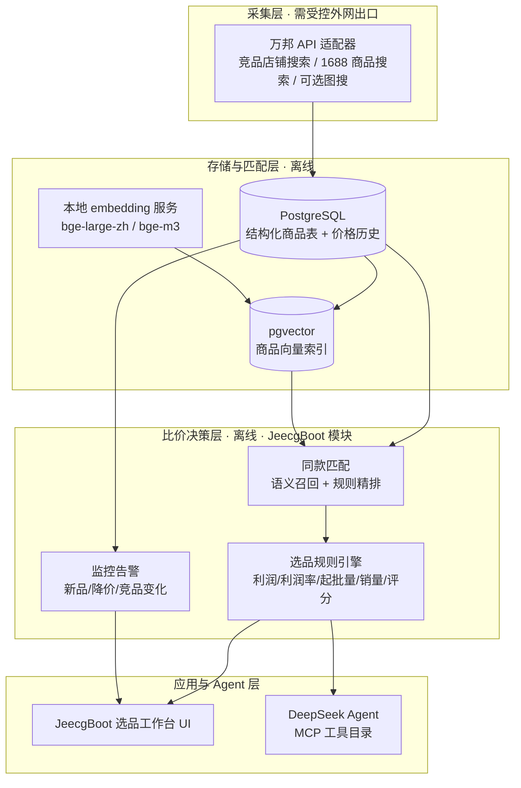
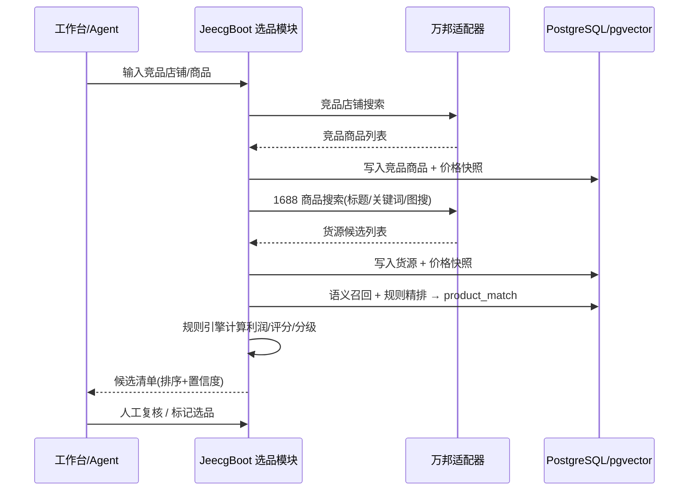

# 全网比价选品系统 · 替代方案规划文档

> 版本：v1.1 ｜ 日期：2026-11-24
> 适用：淘宝竞品店铺 → 1688 货源筛选 → 选品决策 的半自动化闭环
> 定位：在现有 JeecgBoot 业务核心之上，新增轻量「采集 + 匹配 + 比价决策」层，不引入 Quivr / iii engine 等重抽象。

---

## 1. 背景与目标

### 1.1 现有选品流程
1. 对比淘宝竞品店铺，找到对应商品；
2. 在 1688 筛选、判断货源；
3. 筛选出适合的商品（利润、起批量、销量、店铺可靠性等）。

当前依赖人工逛店 + 手动比价，效率低、难沉淀、难监控价格变化。

### 1.2 目标
- 把「竞品商品 → 1688 同款货源 → 评分排序 → 候选清单」做成可复用的半自动流水线；
- 商品与价格数据可沉淀、可追溯（价格历史）；
- 支持新品 / 降价 / 竞品变化的定时监控与提醒；
- 业务函数同时供 JeecgBoot 常规流程与 AI Agent（DeepSeek）对话式编排复用。

### 1.3 硬约束
- **部署环境为内网离线服务器**：运行时、存储、LLM、embedding 全部离线预打包。
- **现有 JeecgBoot 业务核心（应用/权限/团队/模板模块）保持不变**，选品作为新增模块挂接。
- 数据获取优先走 **万邦 API**（竞品店铺搜索、1688 商品搜索）；浏览器采集（browser-use，见 M1-B）与在线搜索为备选/兜底。
- LLM 使用内网 **DeepSeek** endpoint。

> ⚠️ 关键张力：万邦 API / 在线搜索本质需要外网。离线约束作用于「运行时 + 存储 + 模型」，**采集层必须有一个受控外网出口**（见 §7.3）。

---

## 2. 开源现状结论（为什么自建）

GitHub 上**没有完全对口的高 star 整套开源方案**：

| 项目 | Star 量级 | 能力 | 差距 |
|---|---|---|---|
| NanmiCoder/MediaCrawler | ~67–70k | 7 大社媒爬虫 | 不含淘宝/1688，平台不对口 |
| Usagi-org/ai-goofish-monitor | ~18–20k | Playwright+多模态AI 闲鱼监控筛选 | 闲鱼二手，非淘宝竞品→1688 货源 |
| jez500/pricebuddy | ~1k+ | 自托管通用降价追踪+通知 | 通用商品页，无货源匹配/选品决策 |
| 329800187-design/ecommerce-agent-extension | 低 | 闲鱼采集+1688比价+评分规则引擎 | 功能最接近，但闲鱼系、浏览器插件、低 star |
| omkarcloud / Apify / oxylabs / 万邦 | 商业 API | 1688/Alibaba 数据接口 | 仅采集，非整套选品系统 |

**结论**：高 star 项目平台不对口；功能对口的（采集→比价→评分流水线）star 低且基于闲鱼。借鉴其「规则引擎 + 自动评分」思路，在 JeecgBoot 上自建轻量层最贴合现状。

---

## 3. 总体架构

分四层，全部挂接在现有 JeecgBoot 之上：

**设计原则**
- 采集与决策解耦：采集只负责把商品写入知识库；决策只读知识库 + 跑规则。
- 统一函数目录：采集 / 匹配 / 比价 / 告警均封装为可复用函数，JeecgBoot 与 Agent 共用（沿用项目既有约定）。
- 先结构化、后语义：MVP 用结构化表 + 规则即可跑通；向量匹配作为增强项后置。

---

## 4. 核心模块设计

### M1 数据采集适配器（万邦 connector）
- 封装万邦接口：`竞品店铺搜索`、`1688 商品搜索`、（可选）`图搜同款`。
- 统一输出标准化商品 DTO（见 §5），屏蔽接口差异；失败重试 + 配额计数。
- 触发方式：① 工作台手动触发；② 定时任务（监控）；③ Agent 调用。
- 备选：在线搜索适配器（同 DTO 接口），无 API 时降级，但需处理风控/合规（见 §9）。

#### M1-B 浏览器采集实现（browser-use / browser-harness）

作为万邦 API 的替补/补充：直接驱动**已登录的真实浏览器**完成淘宝竞品店铺搜索与 1688 商品搜索，输出同一标准化商品 DTO。

**技术选型**
- browser-harness 现为 browser-use CLI 的内置引擎（MIT 协议），安装：`uv tool install browser-use`。
- 两种驱动模式：
  1. **browser-use 库自主循环**：需 OpenAI 兼容 LLM endpoint（结构化输出 JSON schema + Function Calling），模型自主决策浏览器动作；
  2. **browser-harness MCP + 编码 Agent（Trae）**：`browser-use --cli-mcp` 提供 stdio MCP 服务，由 Agent 自身模型驱动浏览器，**无需另行部署 LLM**，适合先行验证。
- 两者均经 CDP 驱动已登录的真实 Chrome（Chrome 144+ 需在 `chrome://inspect/#remote-debugging` 开启远程调试并 Allow），复用登录态、降低风控触发。

**本地 Qwen3.6-35B-A3B 驱动可行性评估（结论：可行）**
- 模型规格：MoE 总参 35B / 激活 ~3B，256K 上下文，原生多模态（VL 对标 Claude Sonnet 4.5，空间智能 92.0），支持 Function Calling + 结构化输出，SWE-bench Verified 73.4%。
- browser-use 硬性要求 = OpenAI 兼容端点 + 结构化输出（JSON schema）+ FC；官方文档点名支持 qwen 系列。
- 接入方式：`ChatOpenAI(model="qwen3.6-35b-a3b", base_url="http://内网vLLM或SGLang:8000/v1")`。
- 显存按**总权重**估算：FP8 ~35GB / BF16 ~70GB（不能按激活 3B 估算）。
- 场景可行性：**选品 高**；**上品草稿 中偏上**（不发布 + 人工审核兜底）。
- 三大验证点：
  1. vLLM/SGLang 版本是否支持 Qwen3.6 MoE + 多模态 + FC + guided JSON；
  2. 结构化输出 JSON 遵循率（browser-use 每步依赖 schema 输出）；
  3. 淘宝/1688 风控（与模型无关，是主要失败源）。
- 外网出口：浏览器需访问淘宝/1688，LLM 可留内网（与 §7.3 一致）。

**风控策略**：低频拟人操作、专用账号、登录由用户控制、不自动发布（见 M7）。

**试点验证记录（2026-11-24，本机已走通）**
- 路线：Trae Agent → browser-use CLI 1.0.8（browser-harness 0.1.13）→ CDP → 已登录 Chrome → 1688 搜索「保温杯」→ 提取前 10 条标准化商品（标题/价格/销量/起批量/回头率/店铺/链接），端到端成功；
- 关键坑位：
  1. 1688 搜索**必须登录态**，未登录重定向 `login.taobao.com`（临时 profile 不可用，须接管已登录 Chrome）；
  2. `keywords` 参数必须 **GBK 编码**（UTF-8 会乱码、结果错误）；
  3. 商品卡片选择器 `a[href*="detail.1688.com/offer"]`；价格为 `¥/整数/小数` 分行文本需拼接；销量形如「全网10万+件」；店铺名为卡片末行；
  4. Chrome 144+ 需在 `chrome://inspect/#remote-debugging` 勾选 Allow，macOS 权限弹窗可用 `browser-use mac-approve` 处理。
- MCP 已注册 Trae（`browser-use --cli-mcp`，stdio；工具：browser_exec / browser_screenshot / browser_login / browser_feedback），后续会话可直接调用。

### M2 商品知识库
- 结构化存储竞品商品与 1688 货源商品；
- **价格版本历史**：每次采集到的价格快照入 `price_history`，天然支持降价监控与趋势；
- 向量索引（P1 引入）：标题 + 关键规格文本 → 本地 embedding → pgvector。

### M3 跨平台同款匹配
- **召回**：以竞品商品标题/规格做语义检索（pgvector）+ 关键词检索，取 Top-N 候选货源；
- **精排**：规格/属性比对、价格区间合理性、店铺可靠性加权；
- **增强（P3）**：图搜同款（万邦图搜接口）提升同款判定准确率；
- 输出 `product_match`（竞品 ↔ 货源，含置信度）。**语义相似 ≠ 同款**，低置信度强制人工复核。

### M4 比价与选品规则引擎
- 可配置规则（借鉴 ecommerce-agent-extension 的评分思路）：
  - 利润 = 竞品售价 − 1688 进货价 − 预估运费/平台扣点；
  - 利润率阈值、起批量上限、销量下限、店铺评分/复购率下限、价格区间；
- 加权评分 → 分级（如 ≥80 强烈推荐 / ≥60 值得做 / 其余观望）；
- 规则与权重存库，可在 UI 调整，无需改代码。

### M5 监控告警
- 定时采集订阅的竞品店铺 / 关键词 / 货源；
- 触发条件：新品命中、价格下降超阈值、竞品价格/销量变化；
- 通知走 JeecgBoot 现有消息/待办通道（内网友好，不依赖外部 webhook）。

### M6 Agent 编排（DeepSeek + MCP）
- 将 M1–M5 函数注册到统一 MCP 工具目录；
- DeepSeek 通过工具调用完成「查竞品 → 找货源 → 比价 → 给候选」对话式选品；
- 与 JeecgBoot 常规流程共用同一套函数，避免重复实现。

### M7 上品草稿模块（仅草稿，人工审核）
- 基于选品结果（`selection_result`），在**千牛网页端**生成上品草稿：标题、主图、价格、SKU 映射；
- **只保存草稿，不发布**；发布动作一律由人工完成，系统不触碰发布按钮；
- 由 M1-B 浏览器实现驱动，复用已登录的千牛网页会话；
- 草稿状态流转：`生成 → 待审核 → 通过/驳回 →（人工）发布`；
- 草稿数据落 `listing_draft` 表，关联选品结果，全程可追溯；
- 可行性评估：本地 Qwen3.6-35B 驱动为**中偏上**——表单填写类任务结构化程度高，且有人工审核兜底，风险可控（详见 M1-B 评估）。

---

## 5. 数据模型（关键表）

| 表 | 关键字段 | 说明 |
|---|---|---|
| `competitor_shop` | id, platform, shop_name, shop_url, category | 竞品店铺 |
| `competitor_product` | id, shop_id, title, price, sales, specs, image_url, url | 竞品商品 |
| `supply_product` | id, platform(1688), title, price, moq, sales, shop_score, repurchase_rate, specs, image_url, url | 1688 货源 |
| `product_match` | id, competitor_product_id, supply_product_id, confidence, method(semantic/image/rule) | 同款匹配关系 |
| `price_history` | id, product_type, product_id, price, captured_at | 价格快照（竞品/货源通用） |
| `selection_rule` | id, name, metric, operator, threshold, weight, enabled | 选品规则 |
| `selection_result` | id, competitor_product_id, supply_product_id, profit, profit_rate, score, grade, status | 选品结果 |
| `alert_subscription` | id, target_type, target_id, condition, channel, enabled | 监控订阅 |
| `product_vector` | product_type, product_id, embedding(vector) | pgvector 向量（P1） |
| `listing_draft` | id, selection_result_id, platform(qianniu), title, price, sku_mapping, draft_url, status(生成/待审核/通过/驳回), reviewed_by | 上品草稿（M7，仅草稿不发布） |

---

## 6. 选品主流程

---

## 7. 技术选型与离线部署

### 7.1 选型
| 组件 | 选型 | 理由 |
|---|---|---|
| 业务核心 | 现有 JeecgBoot（Java） | 保持不变，复用权限/团队/消息 |
| 存储 | PostgreSQL + pgvector | 结构化 + 向量一库搞定，离线友好 |
| Embedding | 本地 bge-large-zh / bge-m3 | 中文商品语义效果好，可离线 |
| 数据源 | 万邦 API（主）/ 在线搜索（备） | 已有接口，规避爬虫风控 |
| LLM | 内网 DeepSeek endpoint | 离线可用 |
| 调度 | JeecgBoot 定时任务（或现有 Temporal） | 复用既有基础设施 |

### 7.2 离线打包清单
- JeecgBoot 选品模块 jar / 镜像；
- PostgreSQL + pgvector 扩展离线安装包；
- 本地 embedding 模型权重 + 推理服务镜像；
- DeepSeek 内网服务（已有）；
- 万邦适配器配置（API key、配额、出口代理）。

### 7.3 采集层外网出口（必须解决）
万邦 API / 在线搜索需外网，三种合规做法：
1. **受控正向代理**：内网服务器经白名单代理仅访问万邦域名；
2. **采集前置机**：在有外网的机器跑采集，结果同步进内网知识库；
3. **离线批量导入**：定期导出商品数据包导入内网（监控实时性最低）。
> 运行时 / 存储 / 模型 / LLM 仍可全离线，外网出口仅服务于采集。

---

## 8. 分阶段实施计划

| 阶段 | 范围 | 验收标准 |
|---|---|---|
| **P0 MVP** | 万邦采集 + 结构化存储 + 规则比价（无向量） | 输入竞品商品 → 输出 1688 货源候选 + 利润/评分排序，请求-响应跑通 |
| **P1 语义匹配** | pgvector + 本地 embedding + 同款召回精排 | 跨平台同款召回准确率达标，低置信度进入人工复核 |
| **P2 监控告警** | 价格历史 + 定时采集 + 新品/降价提醒 | 订阅竞品/货源后，价格变化能触发内网通知 |
| **P3 Agent + 图搜** | MCP 工具目录 + DeepSeek 编排 + 图搜增强 | 对话式完成选品闭环；图搜提升同款判定 |

> 建议先做 P0 验证价值，再决定是否投入 P1 向量层——若规则 + 关键词已够用，可不上向量，进一步减负。
>
> **浏览器路线试点**：M1-B 浏览器采集与 M7 上品草稿可与 P0 并行试点——先用 browser-harness MCP + Trae 走通端到端（无需另部署 LLM），再评估本地 Qwen3.6-35B 驱动 browser-use 自主循环；万邦 API 作兜底。

---

## 9. 风险与合规

| 风险 | 应对 |
|---|---|
| 万邦 API 配额/费用/外网依赖 | 配额计数 + 缓存去重；采集层受控出口（§7.3） |
| 平台风控/合规 | 优先 API，不爬；在线搜索备选需低频、遵守平台条款，仅内部选品参考 |
| 语义相似 ≠ 同款 | 置信度阈值 + 规格校验 + 图搜 + 强制人工复核 |
| 离线 embedding 选型 | 先小样本评测 bge-large-zh / bge-m3 再定 |
| 价格快照膨胀 | 定期归档/保留策略，控制存储 |

---

## 10. 与 Quivr / iii engine 的取舍

- **Quivr 2**：是内容知识库 + 语义检索 + 告警引擎，无电商采集、无图搜、无数值比价、无 UI，且部署偏重（PostgreSQL + 对象存储 + Temporal + embedding + 插件）。本方案用 **PostgreSQL + pgvector** 即可覆盖其对本场景有价值的部分（知识库 + 语义匹配 + 告警），更轻、更贴合 JeecgBoot。
- **iii engine**：纯请求-响应式调用（触发采集、查状态、跑规则）无需其抽象，直接在 JeecgBoot 实现更简单（沿用既有工程结论）。
- **保留升级空间**：若后续需要「大规模版本化知识库 + 现成告警 + MCP」且团队愿承担运维，可再评估 Quivr 作为 M2/M5 的替换实现，接口（标准化 DTO + 函数目录）已为此解耦。

---

## 附：参考项目
- MediaCrawler：https://github.com/NanmiCoder/MediaCrawler
- ai-goofish-monitor：https://github.com/Usagi-org/ai-goofish-monitor
- pricebuddy：https://github.com/jez500/pricebuddy
- ecommerce-agent-extension（评分规则思路借鉴）：https://github.com/329800187-design/ecommerce-agent-extension
- Quivr：https://github.com/The-Vibe-Company/quivr